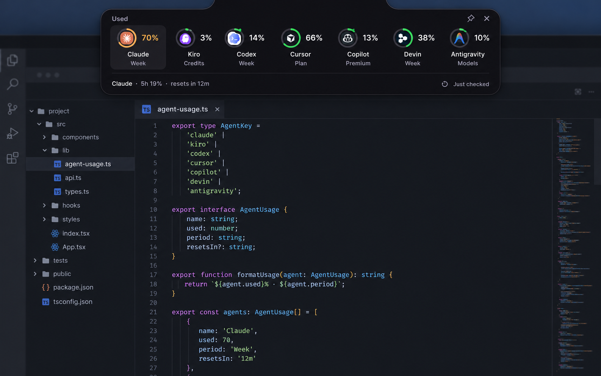
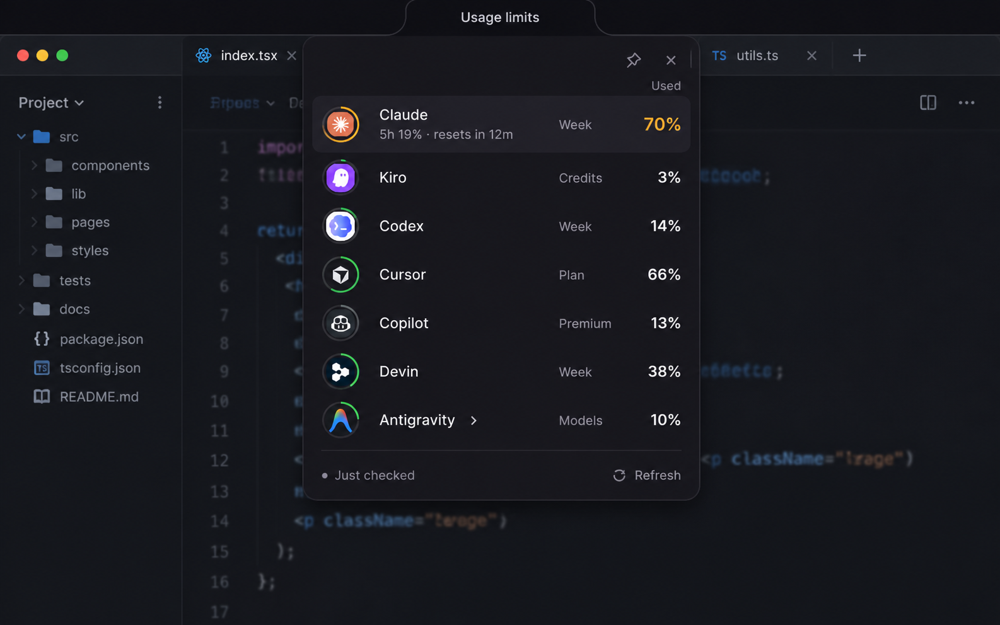
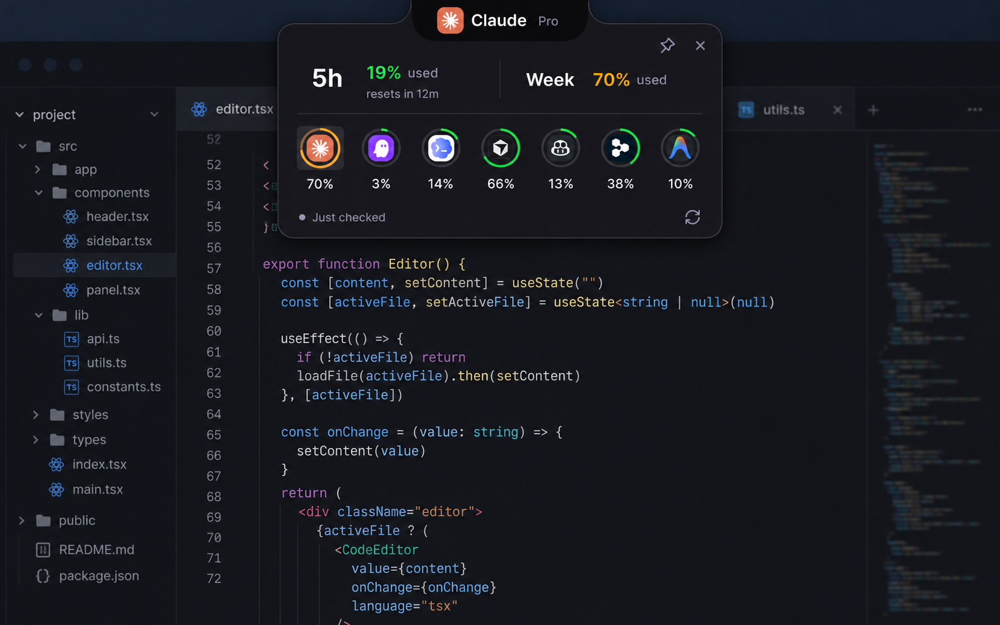

# Top-center notch — second design round

These three independent visual studies refine Orbit using the preceding Impeccable critique. Numbering follows the order the new generated images appeared in chat. This set replaces the first round for numeric selections.

| Choice | Direction | Experience | Tradeoff |
|---|---|---|---|
| [1 — open image](01-seam.png) | Seam | A shallow horizontal overview shows all seven names, percentages and quota bases. One selected-agent detail line reveals the five-hour reset. | Best comparison; widest footprint. Recommended foundation. |
| [2 — open image](02-index.png) | Index | A narrow single-column index aligns complete names, quota bases and percentages. The selected row reveals its additional window inline. | Clearest labels; occupies more vertical space. |
| [3 — open image](03-peek.png) | Peek | Two selected-agent quota windows lead, with a compact seven-agent selector underneath. The large Lens donut is removed. | Small focused inspector; peer identities rely on marks until revealed. |

The product remains the existing Windows, CPU-painted, focus-free quota utility. The design retains Orbit's graphite palette, Inter and authentic agent marks. Selection uses a neutral treatment; amber indicates usage severity. These are generated concept images, with illustrative editor backgrounds and sample readings, not captures of implemented interactions.

Claude's weekly usage is 70%. Its separate five-hour usage is 19%, and only that five-hour window resets in 12 minutes. No weekly reset is invented. The date anchor is 16 October 2026, Asia/Singapore.

The prompts propose logical sizes to compare footprint; the images are visual studies rather than measured native renderings. Exact arc geometry, dimensions, DPI rendering and interaction/accessibility behaviour remain native implementation checks after a direction is selected. The background code is illustrative and is not an implementation source.

## Visuals

### 1 — Seam

### 2 — Index

### 3 — Peek

